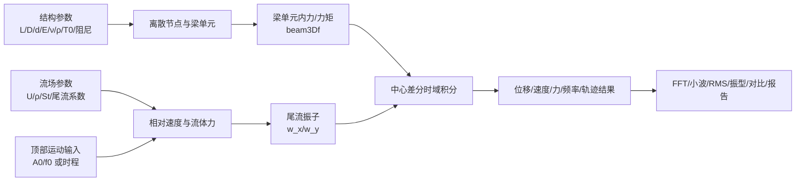
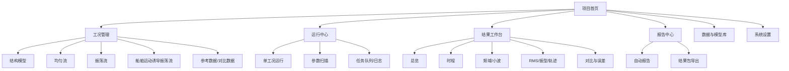
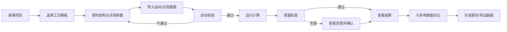
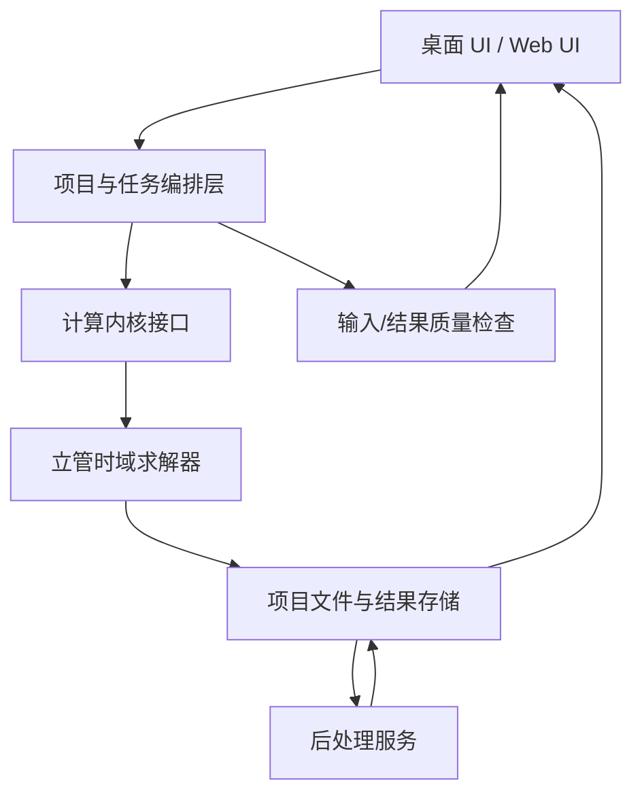

# 立管预报软件
## 工业软件产品需求文档（PRD）

**版本**：V1.0（从科研算例到工程工具的产品化定义）  
**日期**：2026-11-05  
**文档状态**：产品方案评审稿  
**产品代号**：RiserPredict

---

## 1. 产品摘要

### 1.1 产品定位

立管预报软件是一款面向海洋工程、船舶与海洋结构物研发人员的立管涡激振动（VIV）与动力响应分析软件。软件以离散梁/杆单元为结构模型，以时域积分为主线，支持均匀流、振荡流以及船舶运动诱导振荡流等工况，输出位移、速度、流体力、频率、轨迹、振型和 RMS 等工程结果，并支持与试验或外部软件结果进行对比。

### 1.2 核心价值

- 将“修改 MATLAB 参数—运行脚本—手工看图”的科研流程，转化为可复用、可校核、可追溯的工程分析流程。
- 在同一个项目中统一管理立管几何、材料、张力、流场、运动输入、求解控制和后处理配置。
- 用结果卡片和自动报告回答工程用户最关心的问题：是否收敛、响应最大在哪里、主频是多少、是否接近锁定、不同方案哪个更安全。
- 保留研究人员对无量纲系数、尾流模型和边界条件的控制能力，同时通过参数校验和单位管理降低误用风险。

### 1.3 目标用户

| 用户 | 主要任务 | 典型痛点 |
|---|---|---|
| 立管/海洋结构工程师 | 评估流致振动、位移和载荷 | 输入分散，难以复现；缺少统一报告 |
| 水池试验研究人员 | 与试验位移、频率和 RMS 对比 | 数据格式不统一，叠图和误差计算依赖脚本 |
| 数值研究人员 | 修改模型、标定参数、开展参数扫描 | 模型假设藏在代码中，批量计算困难 |
| 项目负责人/审查人员 | 查看工况覆盖、关键指标和结论 | 难以快速判断计算是否有效 |

### 1.4 非目标

V1.0 不承诺替代认证级深海全耦合平台，不包含 CFD、复杂平台—立管—海床全系统耦合、疲劳寿命认证和自动设计优化。相关能力作为后续版本扩展点，需在验证数据充分后进入产品承诺。

---

## 2. 项目现状分析

### 2.1 已识别能力

当前压缩包 `预报软件算例(1).rar` 中共有三类算例目录和配套 MATLAB 文件：

1. **均匀流**：`Case1103.m`、`beam3Df.m`、`ramp_step.m` 及位移、流体力、升阻力系数、RMS、FFT、二维行波、轨迹、振型和小波后处理脚本；附带 Lehn2003、Wang2016 参考数据。
2. **振荡流**：`Case1.m` 及振荡边界、位移时程、小波变换和 Fu 参考数据后处理。
3. **船舶运动诱导振荡流**：`Test_1025.m` 及流场剖面、顶部速度、轨迹、三维频谱、FFT、RMS 和 Riflex 对比脚本。

### 2.2 已实现的计算逻辑

现有代码显示出以下模型链路：



代码中可确认的关键技术点：

- 结构采用空间离散节点和三维梁单元，`beam3Df.m` 计算轴向、弯曲、扭转相关内力和力矩，并更新单元局部坐标系。
- 动力响应采用显式时间循环与中心差分形式更新节点位置、转角和尾流变量。
- 流体侧使用相对速度、平均阻力、波动阻力和升力，尾流状态变量用于计算时变升阻力系数。
- 支持结构阻尼、附加质量、流体阻尼、Strouhal 数和空间流速分布。
- 后处理覆盖时程、RMS、FFT/频谱、小波、二维行波、轨迹、振型和数值—试验/文献对比。

### 2.3 当前产品化缺口

| 现状 | 对工程用户的影响 | 产品化要求 |
|---|---|---|
| 参数写在 `.m` 脚本中 | 易误改、难复用、难审查 | 表单化输入 + 单位 + 校验 + 配置版本 |
| 三类工况由不同主脚本驱动 | 学习成本高，流程不统一 | 统一工况向导与工况模板 |
| 结果主要依靠 MATLAB 图窗和 JPEG | 缺少可交互查询，结果难追踪 | 结果工作台、曲线联动、数据导出 |
| 依赖 `xlsread` 和固定文件名 | 数据来源和路径不透明 | 数据导入、字段映射、数据血缘 |
| 参考结果手工叠图 | 无自动误差指标和结论 | 对比分析、误差统计、结论卡片 |
| 缺少运行日志和收敛判断 | 结果可信度难判断 | 求解监控、异常告警、质量门禁 |
| 脚本中存在注释代码、编码异常和变量耦合 | 维护和迁移风险高 | 计算内核与界面解耦、统一数据契约 |

### 2.4 重要产品判断

现有材料证明了“计算与后处理方法原型”存在，但不能直接证明工程级精度、广泛工况适用性或认证可用性。因此产品界面必须明确区分：

- **计算结果**：软件本次运行得到的数值；
- **验证结果**：与试验、文献或外部软件对比得到的指标；
- **适用性状态**：输入是否完整、时间步长是否满足、结果是否通过质量检查；
- **工程结论**：由用户结合设计准则确认，不由软件在 V1.0 中擅自做安全承诺。

---

## 3. 产品目标与成功指标

### 3.1 V1.0 产品目标

1. 让首次使用的工程师在 30 分钟内完成一个模板工况计算。
2. 让同一个算例可以被完整保存、复制、复算和审查。
3. 将现有三类工况、核心输出和主要后处理能力纳入统一界面。
4. 每次运行都生成带输入快照、模型版本、求解状态和结果摘要的报告包。

### 3.2 可量化成功指标

| 指标 | V1.0 目标 |
|---|---:|
| 模板工况首次运行成功率 | ≥90% |
| 输入校验覆盖率（必填/范围/单位/依赖关系） | 100% |
| 结果报告可追溯率 | 100% |
| 常规算例重复运行结果一致性 | 误差 ≤1e-8（同平台、同随机种子/确定性计算） |
| 失败运行可定位率 | ≥95% 的失败任务给出阶段和原因 |
| 结果导出格式 | CSV、XLSX、PNG/SVG、PDF 至少四类 |

---

## 4. 产品信息架构



### 4.1 顶层导航

- **项目**：新建、打开、复制、归档、版本、项目元数据。
- **工况**：创建工况、编辑参数、校验、克隆、批量运行。
- **运行**：队列、进度、日志、取消、失败重试。
- **结果**：图表、指标、对比、筛选、导出。
- **报告**：报告模板、章节选择、预览、导出。
- **模型/数据**：材料库、流体库、参考数据、单位制、模型参数集。

---

## 5. 核心用户流程



### 5.1 首次运行路径

1. 新建项目，填写项目名称、工程编号、分析人员和单位制。
2. 选择“均匀流—立管 VIV”模板。
3. 在结构面板输入长度、外径、内径、顶张力、单位长度质量、弹性模量、泊松比、结构阻尼和单元数。
4. 在流场面板输入流速剖面、流体密度、附加质量系数、Strouhal 数、平均阻力系数及尾流振子系数。
5. 在求解面板设置总时间、积分步长、输出间隔、加载斜坡时间和输出节点/截面。
6. 点击“校验”，查看单位、数值范围、边界条件和时间步长建议。
7. 点击“运行”，在运行中心查看进度、当前时间、节点数、异常计数和剩余时间。
8. 计算结束后进入结果总览，查看最大位移、RMS、主频、最大流体力和结果状态。
9. 选择时程、频谱、轨迹、振型或对比页，生成图表和报告。

---

## 6. 功能需求

### 6.1 项目与工况管理

| 编号 | 需求 | 优先级 | 验收标准 |
|---|---|---|---|
| FR-P01 | 新建/打开/复制/归档项目 | P0 | 项目可在关闭软件后恢复，复制项目不覆盖原项目 |
| FR-P02 | 工况模板 | P0 | 提供均匀流、振荡流、船舶运动诱导振荡流三种模板 |
| FR-P03 | 工况克隆与参数对比 | P0 | 可对比两工况参数差异并标出变更项 |
| FR-P04 | 输入快照 | P0 | 每次运行自动保存完整输入、软件版本和模型版本 |
| FR-P05 | 单位制切换 | P1 | 支持 SI 制；切换后数值等价且界面单位同步变化 |

### 6.2 结构模型

| 编号 | 需求 | 优先级 | 验收标准 |
|---|---|---|---|
| FR-S01 | 立管几何 | P0 | 支持长度 L、外径 D、内径 d，并实时显示截面积和惯性矩 |
| FR-S02 | 材料与质量 | P0 | 支持 E、ν、结构质量/密度、内部流体密度；派生量可追溯 |
| FR-S03 | 张力与阻尼 | P0 | 支持顶张力 T0、结构阻尼比 ξ，并标明其作用范围 |
| FR-S04 | 空间离散 | P0 | 支持单元数 N；显示节点数 N+1，并提示过粗/过细风险 |
| FR-S05 | 边界条件 | P0 | 支持顶部/底部位移、速度、运动输入，显示三方向约束状态 |
| FR-S06 | 三维预览 | P1 | 根据长度、节点数和边界条件显示初始立管几何 |

### 6.3 流场与激励

| 编号 | 需求 | 优先级 | 验收标准 |
|---|---|---|---|
| FR-F01 | 均匀流 | P0 | 输入常值流速或节点流速剖面，支持空间插值/分段输入 |
| FR-F02 | 振荡流 | P0 | 支持振幅 Ao、频率 fo、流体密度和振荡方向 |
| FR-F03 | 船舶运动诱导振荡流 | P0 | 支持顶部运动正弦输入和外部时程导入 |
| FR-F04 | 尾流振子 | P0 | 支持 St、Ax、Ay、εx、εy、CD0、CL0、平均阻力等参数 |
| FR-F05 | 相对速度 | P0 | 展示相对速度定义、分量和攻角，避免绝对值处理不可见 |
| FR-F06 | 流场剖面 | P1 | 可视化时间—空间流速/激励幅值并导出图片和数据 |

### 6.4 求解与运行控制

| 编号 | 需求 | 优先级 | 验收标准 |
|---|---|---|---|
| FR-R01 | 求解控制 | P0 | 支持总时间 ET、时间步长 h、输出间隔 Tpr、斜坡时间 rtime |
| FR-R02 | 稳定性提示 | P0 | 根据 h、网格尺寸、频率和阻尼给出警告，不合格时禁止运行或要求确认 |
| FR-R03 | 运行监控 | P0 | 显示进度、仿真时间、壁钟时间、速度、内存和错误计数 |
| FR-R04 | 任务控制 | P0 | 支持暂停、取消、失败重试、复制任务；取消后保留日志和部分结果 |
| FR-R05 | 批量/参数扫描 | P1 | 可选择一组参数范围，生成任务列表并分别保存结果 |
| FR-R06 | 计算日志 | P0 | 记录输入摘要、求解阶段、异常、告警、结束状态和运行耗时 |

### 6.5 结果与后处理

| 编号 | 需求 | 优先级 | 验收标准 |
|---|---|---|---|
| FR-V01 | 结果总览 | P0 | 显示最大值、RMS、主频、最大载荷、位置和时间 |
| FR-V02 | 位移/速度/力时程 | P0 | 可按节点、归一化位置、方向和时间窗口筛选并联动查看 |
| FR-V03 | 频域分析 | P0 | 支持 FFT，显示频率、幅值、峰值频率和节点/位置维度 |
| FR-V04 | 小波分析 | P1 | 展示时间—频率/尺度图，支持窗口和颜色范围配置 |
| FR-V05 | RMS 分布 | P0 | 沿立管长度显示 X/Y/Z 位移 RMS，并支持归一化到 D 或 L |
| FR-V06 | 轨迹与三维形态 | P0 | 绘制节点轨迹、立管响应形态及特定时刻快照 |
| FR-V07 | 振型/行波 | P1 | 支持主振型、二维行波和空间频率展示 |
| FR-V08 | 升阻力系数 | P0 | 显示 CD/CL 时程、均值、RMS 与空间分布 |
| FR-V09 | 外部数据对比 | P0 | 支持 CSV/XLSX 导入、字段映射、单位换算、叠图和误差统计 |
| FR-V10 | 图表导出 | P0 | 支持 PNG、SVG、PDF，图中包含工况名、时间、单位和软件版本 |

### 6.6 报告与数据治理

| 编号 | 需求 | 优先级 | 验收标准 |
|---|---|---|---|
| FR-G01 | 自动报告 | P0 | 生成项目摘要、输入参数、求解状态、关键结果、图表和告警 |
| FR-G02 | 报告章节选择 | P1 | 用户可选择结构、流场、时程、频域、对比和结论章节 |
| FR-G03 | 结果包 | P0 | 一键导出输入快照、原始结果、派生结果、图表、日志和报告 |
| FR-G04 | 数据血缘 | P0 | 每张图表显示来源工况、结果版本和后处理配置 |
| FR-G05 | 权限与审查 | P2 | 支持只读分享和审查意见，不在 V1.0 强制引入复杂权限系统 |

---

## 7. 界面草图（低保真）

### 7.1 主界面

```text
┌─────────────────────────────────────────────────────────────────────────┐
│ 立管预报软件  项目：Case1103-VIV       [校验] [运行] [导出报告] [帮助]     │
├──────────────┬──────────────────────────────────────────┬─────────────────┤
│ 项目导航      │ 结果总览                                 │ 工况摘要         │
│              │ ┌────────┬────────┬────────┬──────────┐ │ 类型：均匀流     │
│ ▸ 项目        │ │最大位移│ RMS    │主频    │最大流体力│ │ L/D/N            │
│ ▾ 工况        │ │  0.00  │  0.00  │  0.00  │   0.00   │ │ 边界条件         │
│   结构模型    │ └────────┴────────┴────────┴──────────┘ │ 校验状态         │
│   均匀流      │                                          │ 运行状态         │
│   振荡流      │ [位移时程] [RMS分布] [频谱] [轨迹]       │                 │
│   船舶诱导流  │ ┌──────────────────────────────────────┐ │                 │
│ ▸ 运行中心    │ │                                      │ │                 │
│ ▸ 结果工作台  │ │             交互式图表区             │ │                 │
│ ▸ 报告中心    │ │                                      │ │                 │
│ ▸ 模型/数据   │ └──────────────────────────────────────┘ │                 │
└──────────────┴──────────────────────────────────────────┴─────────────────┘
```

### 7.2 参数录入原则

- 表单按“结构—流场—边界—求解—输出”分组，不让用户面对 MATLAB 变量名。
- 每个字段显示：中文名称、符号、单位、默认值、来源和帮助说明。
- 派生量只读展示，例如截面积、惯性矩、附加质量、节点数、漩涡脱落频率。
- 错误分为“阻止运行”的错误和“允许确认”的告警。
- 用户可以切换“工程模式”和“研究模式”：工程模式隐藏高风险内部参数，研究模式开放尾流振子及数值细节。

---

## 8. 数据模型与文件格式

### 8.1 项目对象

```text
Project
├── project.json              项目元数据、单位制、软件版本
├── cases/
│   └── case-xxxx/
│       ├── case.json         工况输入快照
│       ├── runs/
│       │   └── run-yyyy/
│       │       ├── manifest.json
│       │       ├── raw/       原始时程与节点结果
│       │       ├── derived/   RMS/FFT/小波/峰值等派生结果
│       │       ├── figures/   图表
│       │       ├── logs/      运行日志
│       │       └── report/    报告
│       └── references/        试验/文献/外部软件数据
└── library/                   材料、流体和模型参数集
```

### 8.2 核心数据字段

| 数据域 | 关键字段 |
|---|---|
| 结构 | L、D、d、A、E、ν、G、Iy、Iz、J、m、T0、ξ、N |
| 流体 | ρe、ρi、U(z)、Ca、St、Ax、Ay、εx、εy、CD0、CL0、CDavg |
| 运动 | 输入类型、方向、振幅、频率、时程文件、单位、采样间隔 |
| 求解 | ET、h、Tpr、rtime、积分算法、初始条件、边界条件 |
| 原始结果 | t、node、z/L、x/y/z、vx/vy/vz、Fx/Fy/Fz、CD/CL、尾流状态 |
| 派生结果 | max、mean、RMS、peak frequency、相位、误差、质量状态 |

### 8.3 外部数据导入

首版支持 CSV/XLSX。导入向导必须要求用户确认：列含义、单位、空间坐标、时间列、方向、是否已去除均值以及参考长度。原始文件只读保存，转换后的数据另存，避免覆盖用户数据。

---

## 9. 计算质量与校验规则

### 9.1 输入校验

- `L > 0`、`D > 0`、`0 ≤ d < D`、`N ≥ 2`、`ET > 0`、`h > 0`、`Tpr ≥ h`。
- 顶张力、质量、密度、弹性模量、阻尼比不可为负；阻尼比超过工程常用范围时告警。
- `h` 与最高关注频率、单元尺寸和波传播时间步长进行稳定性检查。
- 运动输入的采样间隔必须与仿真时间覆盖范围一致；缺失值、重复时间戳和单位不明时阻止运行。
- 顶部/底部约束不能产生未定义自由度；运动边界与固定边界同时存在时必须显式提示。

### 9.2 运行后质量检查

- 时间序列长度是否完整、时间是否单调递增。
- 是否出现 NaN、Inf、位移/速度突跳、节点长度趋近零。
- 能量或关键响应是否在用户设定窗口内稳定。
- 结果是否包含所有请求输出节点和方向。
- 结果图表是否带有单位、数据来源和运行 ID。

### 9.3 结果状态

`通过`：输入和运行检查均通过。  
`带告警`：计算完成，但存在需审查的数值或适用性告警。  
`失败`：未完成或结果不完整。  
`仅研究`：计算完成，但模型/验证证据不足，不应作为工程承诺。

---

## 10. 非功能需求

| 类别 | 要求 |
|---|---|
| 可用性 | 中文优先，关键术语显示中英文/符号；常用操作不超过 3 次点击到达 |
| 性能 | 计算与界面解耦；图表加载采用降采样，不因长时程阻塞界面 |
| 稳定性 | 任务失败不丢失输入；软件重启后可恢复最近项目和运行状态 |
| 可追溯性 | 输入、模型、求解、后处理、导出均有版本和时间戳 |
| 可扩展性 | 计算内核通过统一接口接入新工况和新尾流模型 |
| 兼容性 | 首选 Windows 64 位；研究模式支持从现有 MATLAB 算例导入/导出 |
| 安全性 | 项目文件本地保存；导出报告不包含未选择的原始数据 |
| 可维护性 | 中文编码统一 UTF-8；禁止通过固定工作目录和隐式全局变量传递数据 |

---

## 11. 版本规划

### V1.0：可用的工程分析原型

- 统一项目/工况/运行/结果/报告流程。
- 三类现有工况模板。
- 结构、流场、边界、求解参数表单与校验。
- 位移/速度/流体力时程、RMS、FFT、轨迹、基础对比。
- CSV/XLSX/PNG/SVG/PDF 导出。
- 输入快照、运行日志、结果包和自动报告。

### V1.1：研究效率增强

- 小波、振型、二维行波、流场剖面。
- 参数扫描与任务队列。
- 外部软件结果适配器和更完善的误差统计。
- 材料库、流体库和组织级模板。

### V2.0：工程决策支持

- 多段立管、非均匀截面和更复杂边界。
- 平台运动多自由度输入。
- 疲劳相关统计、长期海况批处理和设计方案排序。
- 经充分验证后再考虑工程限值检查与认证工作流。

---

## 12. 技术架构建议



建议将现有 MATLAB 原型分为四层迁移：

1. **模型层**：结构、流体、边界、尾流和求解参数对象。
2. **求解层**：`beam3Df`、时域积分、边界处理和状态更新。
3. **后处理层**：时程、RMS、FFT、小波、轨迹、振型和对比。
4. **产品层**：项目管理、输入校验、任务编排、图表、报告和导出。

第一阶段不应同时重写所有算法。应先为现有主脚本建立稳定的“输入 JSON → 计算结果文件 → 派生结果”的适配器，再逐步替换脚本内部耦合。

---

## 13. 测试与验收方案

### 13.1 基线算例

将当前三个主算例登记为回归基线：

- `均匀流/Case1103.m`：L=9.63、D=0.02、顶张力 817、N=18、ET=35 s。
- `振荡流/Case1.m`：L=4、D=0.024、顶张力 500、N=8、ET=130 s、Ao=0.68、fo=1/16.5。
- `船舶运动诱导振荡流/Test_1025.m`：L=8.996、D=0.028、顶张力 212、N=10、ET=200 s、Ao=0.078、fo=0.646。

### 13.2 验收层级

1. **单元测试**：截面属性、旋转矩阵、梁单元力、边界条件、RMS/FFT 数据处理。
2. **回归测试**：相同输入下，与现有脚本关键时程、RMS 和主频对比。
3. **可用性测试**：新用户按模板完成建模、运行、查看和导出。
4. **验证测试**：与已有试验/文献/外部软件数据对比，报告误差和差异来源。
5. **异常测试**：缺失文件、极端参数、NaN、零长度单元、时间步长过大、任务中断。

### 13.3 发布门槛

- 三个基线算例可完成端到端运行。
- 所有 P0 功能通过验收。
- 关键结果与原始脚本的差异有记录、有解释。
- 任何未完成验证的模型能力都标为“研究/试用”，不进入默认工程结论。

---

## 14. 风险与待确认事项

| 风险/问题 | 影响 | 处理建议 |
|---|---|---|
| 现有脚本变量耦合、依赖工作区状态 | 重构后结果漂移 | 先建立输入输出契约和回归基线 |
| 部分代码存在编码异常 | 界面/报告乱码 | 迁移时统一 UTF-8，并保留原文件只读备份 |
| `xlsread`、固定文件名和手工绘图 | 自动化和跨平台受限 | 改为显式数据源、字段映射和统一导出 |
| 相对速度、阻尼、尾流参数的物理假设 | 结果解释风险 | 在参数帮助和报告中展示模型假设 |
| 缺少系统验证矩阵 | 工程适用边界不清 | 建立工况—指标—参考来源矩阵 |
| 计算耗时可能随 ET、h、N 快速增长 | 用户体验差 | 任务队列、降采样、断点/取消和性能剖析 |

### 14.1 需要产品/技术负责人确认

- 首版目标平台：Windows 桌面、跨平台桌面，还是 MATLAB App Designer。
- 计算内核路线：继续 MATLAB Runtime，还是迁移至 Python/C++。
- 是否需要与 OrcaFlex、RIFLEX、OpenFAST 或试验采集系统建立正式接口。
- 工程输出是否需要采用企业模板、签名或审查流程。
- V1.0 是否只服务科研/试验团队，还是直接面向设计院工程项目。

---

## 15. 一句话版本定义

**RiserPredict V1.0 = 一个能把三类立管流致振动 MATLAB 算例，转化为“可配置、可运行、可校核、可对比、可报告”的工程分析工作台。**

